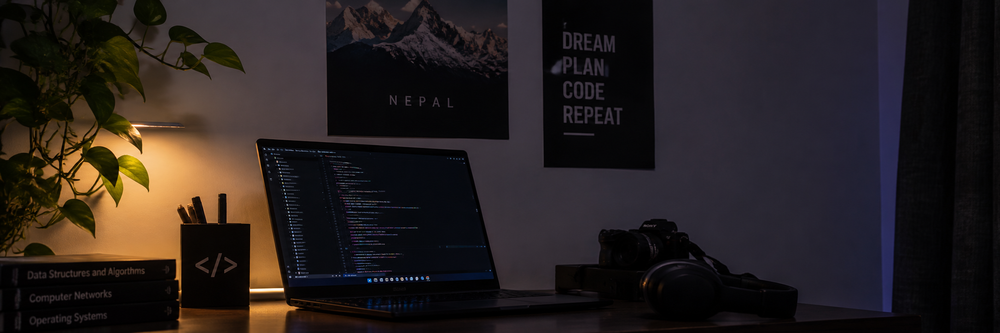

  

  <h1>Hi 👋, I'm Utsav Acharya</h1>

  <h3>Computer Engineering Student from Nepal 🇳🇵</h3>

  
<b>Build • Create • Explore</b>

## 👨‍💻 About Me

- 🎓 Computer Engineering student at IOE, Tribhuvan University
- 🌱 Currently learning C, C++, JavaScript, and Object-Oriented Programming
- 💻 Building web and desktop applications
- 🤝 Interested in collaborating on creative and software projects
- 🚀 Always exploring and learning new technologies

---

## 🌐 Connect With Me

  
  

---

## 🛠️ Tech Stack

### 💻 Programming Languages

  
  
  

### 🌐 Web Development

  
  

### 🖥️ Desktop Development

  

### 🔧 Tools

  
  
  
  

---

## 📌 Featured Projects

### 🌪️ Disaster Management & Rescue Coordination System
A C++ console-based OOP project for managing disaster records, rescue teams, and resources.

### 🔐 C-Krypt
A C-based password vault demonstrating file handling, structures, and basic XOR encryption.

---

## 📊 GitHub Stats

---

✨ **Always learning, always building. 🚀**

